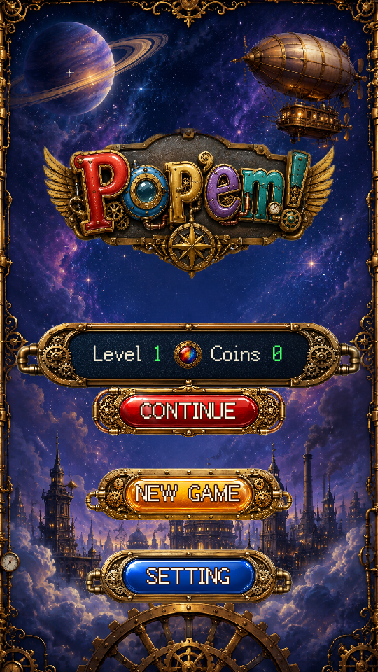
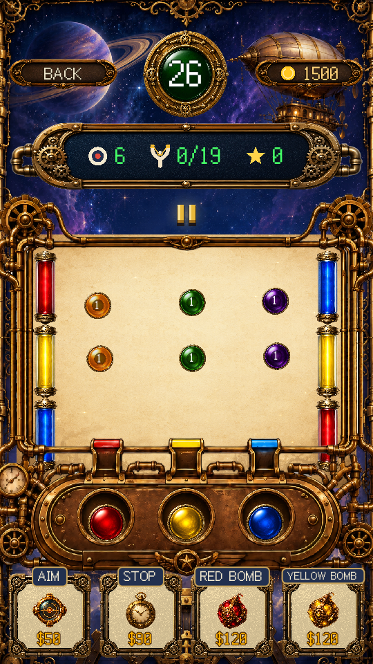

# POP'EM! / 彩弹爆爆

使用 **Godot 4.6 + GDScript** 制作的竖屏弹射消除游戏。拉动彩球、瞄准并松手，命中同色目标；后续关卡逐步加入墙壁染色、目标血量、黑洞、合体和混色。

[English](README.md) · [贡献指南](CONTRIBUTING.md) · [素材与第三方许可](THIRD_PARTY_NOTICES.md)

<p> </p>

## 运行

1. 安装 [Godot 4.6.3 标准版](https://godotengine.org/download/)（不需要 .NET 版）。
2. 克隆仓库，或下载 ZIP 并解压。
3. 在 Godot 中导入 `project.godot`，等待首次资源导入结束。
4. 按 **F5** 运行。

无需注册、API Key、付费服务或额外插件。运行所需的图片、音乐、音效和字体均已包含。桌面显卡无法使用 Mobile 渲染器时，可以尝试 `godot --path . --rendering-method gl_compatibility`。

鼠标或触屏均可操作：把发射区彩球向下或侧向拉动，松手发射；命中同色目标即可消除。第 26 关起，把一种基础色拖到另一种颜色上即可混色：红黄变橙、黄蓝变绿、红蓝变紫。新增机制会在游戏内显示教学。

## 当前范围

- 30 个关卡，分为六组。
- 瞄准器、彩色炸弹、冻结、水晶球、反物质、追踪导弹和粉毛球。
- 英语、简体中文、繁体中文。
- 本地存档、选关、游戏内奖励金币和音量设置；没有支付功能。
- 自定义球体运动与碰撞、粒子、部分合成音效和界面动画。
- 25 项回归检查，包含触摸取消时不误发球或误购道具。

这是现有 30 关版本的首次公开源码版，保留原有“试玩版通关”画面；仓库不承诺新增关卡或商业正式版的发布时间。

## 测试与导出

安装 Python 3.10+ 后运行：

```sh
python tools/run_tests.py --godot godot
```

Windows 可把 `godot` 换成 Godot 控制台程序的完整路径。测试在 `.test-runs/` 中的独立副本运行，存档被重定向到测试目录，不会覆盖玩家进度。日志保留在该目录。详细说明见 [tests/README.md](tests/README.md)。

导出时在 Godot 的“项目 → 导出”中新建自己的预设，并安装对应版本的导出模板。Android 还需要配置 SDK 和 JDK。仓库不包含商店签名密钥或本机导出配置，分发衍生版本时请使用自己的应用标识和签名。

## 许可

项目自有源码、文档、美术及音频在维护者拥有可授权权利的范围内采用 [MIT](LICENSE)；部分美术和音频使用 AI 辅助制作。Fusion Pixel 及其字体组件保持 **SIL OFL 1.1**，许可原文已保留。Godot 引擎及第三方组件的署名要求见 [THIRD_PARTY_NOTICES.md](THIRD_PARTY_NOTICES.md)。MIT 不授予 POP'EM! 或 Netzilla Studio 商标权，也不表示官方认可衍生版本。
